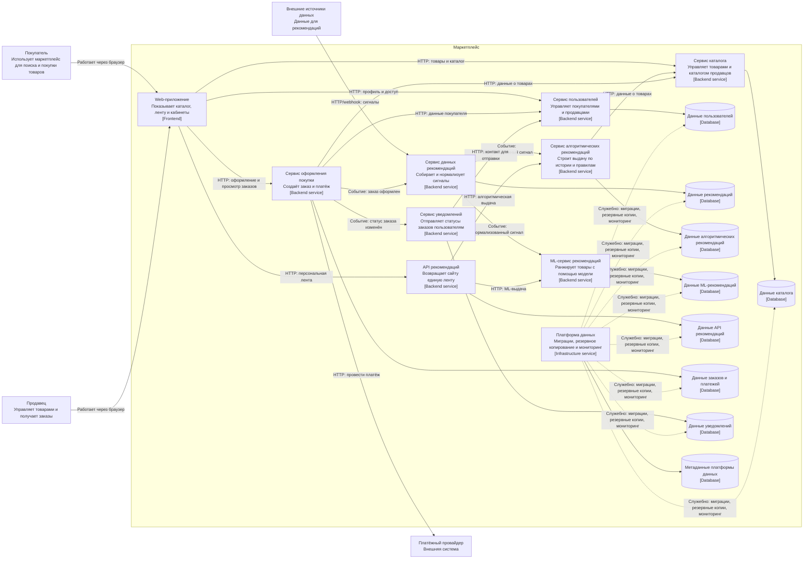

# C4 Container: маркетплейс

## Назначение диаграммы

Диаграмма показывает крупные части маркетплейса, их ответственность, хранилища и основные связи.

## Как читать

- Рамка «Маркетплейс» — одна система в границах задания.
- Внутри находятся приложения и хранилища данных: это контейнеры в C4.
- Покупатель, продавец, платёжный провайдер и источники данных находятся снаружи системы.
- Сплошные стрелки с `HTTP` — синхронные вызовы; стрелки с «Событие» — асинхронный обмен.
- Каждый бизнес-сервис использует собственную базу данных. Сервис оформления покупки владеет одной базой, потому что он объединяет домены заказов и платежей.
- Домен рекомендаций разделён между сервисами данных, алгоритмической выдачи, ML-выдачи и API рекомендаций.
- Пунктирные стрелки платформы данных — служебные операции. Платформа не участвует в обработке пользовательских запросов и не получает бизнес-данные сервисов.

## Границы диаграммы

- Конкретный алгоритм рекомендаций, обучение модели и формат данных внешних источников не являются частью задания.
- Платформа данных обслуживает уже созданные хранилища; её недоступность не должна останавливать выполнение пользовательских запросов.
- Доставка, реклама и техподдержка не показаны, поскольку не входят в требования рассматриваемого кейса.
